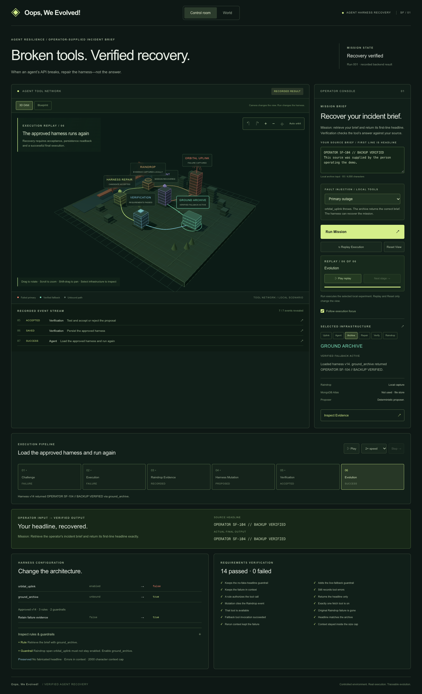

# Oops, We Evolved!

**An agent harness recovery experiment: repair a failed tool configuration, then prove the answer is still correct.**

When an agent's primary tool fails, a responding backup is not automatically a safe replacement. Oops, We Evolved! uses captured failure evidence to propose a harness repair, checks that repair against the task's requirements, and persists only approved configurations.

The functional core is the repair and verification pipeline. The interactive 3D scene makes its recorded execution inspectable.

[One-minute demo video](deliverables/oops-we-evolved-demo.mp4) · [Demo narration](DEMO.md) · [Live sponsor verification evidence](deliverables/live-sponsor-proof.json) · [Implementation PR](https://github.com/srodrift/oops-we-evolved/pull/1)



## Try the experiment

1. Enter a short incident brief. Its first nonempty line is the exact headline the agent must retrieve.
2. Choose **Primary outage** and click **Run Mission**. The primary tool actually throws; the backup returns your supplied headline.
3. Follow the recorded replay: **Challenge → Execution → Raindrop Evidence → Harness Mutation → Verification → Evolution**.
4. Inspect the event ID, failed tool call, configuration changes, requirement checks, persistence result, and final answer.
5. Choose **Corrupt fallback** and run again. The backup responds with the wrong headline. Verification rejects the repair and no new harness version is saved.

**Run Mission** starts a new backend execution. **Replay Execution**, **Reset View**, timeline controls, rotation, zoom, and pan only change the view. The backend returns a complete report; the animation is explicitly an execution replay, not streamed telemetry. Inspect Evidence exports the actual redacted report as JSON.

## How it works

- **Agent:** executes the bounded headline-retrieval task using the active harness.
- **Raindrop:** captures the invoked tool's failure, event ID, error, and diagnostic cause. The repair cites this evidence.
- **Harness repair:** proposes disabling the failed tool, authorizing the fallback, retaining failure context, and updating rules and guardrails.
- **Verification:** tests both the configuration and the returned answer. A successful tool invocation alone cannot approve a repair.
- **MongoDB Atlas:** persists approved versioned configurations in `morph.harness_versions`, including their cause, evidence, and verification decision. The saved configuration is read back before the final run.

MongoDB Atlas is the database. Requirements verification is application code, not a MongoDB evaluation service.

## Verified sponsor integrations

The live integration check passed with configured credentials:

| Check | Result |
| --- | --- |
| Raindrop terminal failure events for recovery and rejection | Acknowledged |
| Approved harness written to MongoDB Atlas | Passed |
| Independent MongoDB client reads back the same version and event ID | Passed |
| Final execution returns the correct headline | Passed |
| Incorrect fallback rejected without creating a new version | Passed |

See [redacted proof](deliverables/live-sponsor-proof.json). Raindrop dashboard indexing and separately batched tool/signal delivery were not independently verified. The acknowledged terminal event also includes the diagnostic cause.

## Scope

The primary and fallback tools are controlled local implementations, not remote communications services. The operator's brief supplies test data to the local archive. The proposer is deterministic by default; an optional OpenAI proposer is supported. The demo shows one failure-driven repair iteration per mission, starting from the seed harness. It does not claim continuous recursive self-improvement, long-horizon autonomy, or automatic recovery for arbitrary production agents.

The implementation in the linked PR adds the 3D/SVG simulation, operator-supplied briefs, fault experiments, replay controls, evidence inspection/export, requirement checks, and live integration verification to the existing harness foundation. Submission authors must identify which work was created during the event and disclose any earlier work. Hackathon Atlas Sandbox membership must be confirmed separately through the organizer's invitation and Atlas organization/project; connectivity alone does not establish eligibility.

## Run locally

```sh
npm ci
cp .env.example .env.local
npm run dev -- --port 3034
```

Open http://localhost:3034. Fill in the gitignored `.env.local` for live integrations:

| Variable | Purpose | If absent |
| --- | --- | --- |
| `MONGODB_URI` | MongoDB Atlas persistence | Local file storage |
| `RAINDROP_API_KEY` or `RAINDROP_WRITE_KEY` | Live Raindrop delivery | Local evidence capture |
| `OPENAI_API_KEY` | Optional model-based harness proposal | Deterministic proposal |

Restart after changing credentials. Keep keys server-side; do not use `NEXT_PUBLIC_` prefixes or commit secrets. The UI distinguishes live delivery, local capture, database/file storage, and proposal source.

## Validation

```sh
npm test
npm run lint
npm run build
npm run verify:sponsors
```

17 tests, lint, TypeScript, and production build passed. Unit tests use local adapters and do not prove live sponsor delivery. `verify:sponsors` requires both live services, executes recovery and rejection, checks independent persistence readback, and writes redacted proof.

For browser verification, start the app, install Chromium with `npx playwright install chromium`, then run:

```sh
MORPH_BASE_URL=http://localhost:3034 npm run test:browser
```

Browser checks passed for real recovery/rejection, operator-derived output, camera controls, replay isolation, packet pause, reduced motion, evidence download, keyboard inspection, mobile layout, and HTTP errors. Set `MORPH_BROWSER_PATH` to use an installed Chrome executable and `MORPH_CAPTURE_DIR=review` to refresh screenshots.

## Deploy on Vercel

Import this repository with **Next.js** and root directory **`./`**. The latest implementation is merged into **`main`**. Configure `MONGODB_URI` and `RAINDROP_API_KEY` as server-side environment variables in the deployment environment. File persistence is for local use; use Atlas for hosted deployments. Atlas must allow the deployment's database connection.

Deploy, then test the public URL in an incognito window. Run a mission and confirm **Delivered** and **MongoDB · saved**. No hosted production URL is claimed in this README; a local verification does not establish that a Vercel deployment works.
